

<a href="https://davidasaolu.dev">
  <picture>
    <source media="(prefers-color-scheme: dark)" srcset="assets/header-dark.svg" />
    
  </picture>
</a>

<a href="https://davidasaolu.dev/software">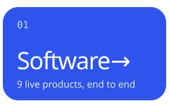</a> <a href="https://davidasaolu.dev/writing">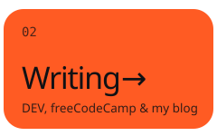</a> <a href="https://davidasaolu.dev/content">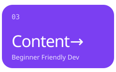</a> <a href="https://davidasaolu.dev/research">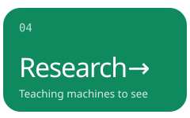</a>

 

I’m a **software engineer and technical writer who helps startups grow**. I build full-stack products, and I write engaging tutorials and articles that market your product to developers and turn readers into users. My work runs on freeCodeCamp and DEV, including dev-rel content for Stream.

> 🚀 **Open to work with startups:** technical content, developer marketing and product engineering. **[Let’s talk →](https://davidasaolu.dev/#contact)**

On the side, I research **computer vision** (detection, segmentation and multimodal models) and I’m open to **graduate research opportunities**. I graduated top of my class in Computer Science with First Class Honours (4.8/5).

Everything lives at **[davidasaolu.dev](https://davidasaolu.dev)**.

<table>
<tr>
<td width="50%" valign="top">

### ✍️ Latest writing

<!-- WRITING:START -->
- [How to Build an AI Social Media Post Scheduler Using Gemini and Late API in Next.js](https://www.freecodecamp.org/news/how-to-build-an-ai-social-media-post-scheduler-using-gemini-and-late-api-in-nextjs/) freeCodeCamp · Jan 2026
- [Build a Google Docs-Style Editor with NextJS and Quill](https://dev.to/getstreamhq/build-a-google-docs-style-editor-with-nextjs-and-quill-4fc2) DEV · Nov 2025
- [Build a Snapchat Clone with Streaks Using Nextjs & Firebase](https://dev.to/getstreamhq/build-a-snapchat-clone-with-streaks-using-nextjs-firebase-3m4n) DEV · Oct 2025
- [Build a Gaming App with Next.js and Firebase](https://dev.to/getstreamhq/how-i-built-a-multiplayer-gaming-app-with-nextjs-and-firebase-2kif) DEV · Jul 2025
- [Build a Therapy Marketplace Using Next.js and Firebase](https://dev.to/getstreamhq/build-a-therapy-marketplace-using-nextjs-and-firebase-37) DEV · May 2025
<!-- WRITING:END -->

[All articles →](https://davidasaolu.dev/writing)

</td>
<td width="50%" valign="top">

### ▶️ Latest videos

<!-- VIDEOS:START -->
- [Build a Google Docs-Style Collaborative Editor with Nextjs Stream, and QuillJS](https://www.youtube.com/watch?v=UxszD2grJ5M) Nov 2025 · 52 views
- [Build a Snapchat Clone with Streaks Using Next.js, Stream and Firebase](https://www.youtube.com/watch?v=i6Y_X2r_U3Q) Oct 2025 · 110 views
- [Build a Multiplayer Gaming App with Next.js, Stream and Firebase](https://www.youtube.com/watch?v=n9Owt2wXHp0) May 2025 · 311 views
- [DEMO: Build a Job Application & Interview Platform with Next.js and Stream](https://www.youtube.com/watch?v=oa3Pu0izQfs) Apr 2025 · 236 views
<!-- VIDEOS:END -->

[Beginner Friendly Dev on YouTube →](https://www.youtube.com/@beginner_friendly_dev)

</td>
</tr>
</table>

### 🛠️ Things I’ve built

<table>
  <tr>
    <td width="33%" valign="top">
      <a href="https://sharpbill--sharpbill-2b40a.us-east4.hosted.app/">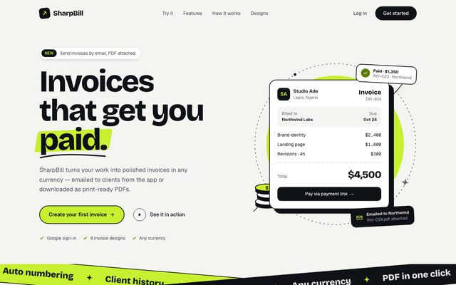</a>
       <b><a href="https://sharpbill--sharpbill-2b40a.us-east4.hosted.app/">SharpBill</a></b> · Invoicing for freelancers
       <a href="https://sharpbill--sharpbill-2b40a.us-east4.hosted.app/">Live ↗</a> · <a href="https://github.com/dha-stix/sharpbill">Code</a>
    </td>
    <td width="33%" valign="top">
      <a href="https://evently-rho-six.vercel.app/">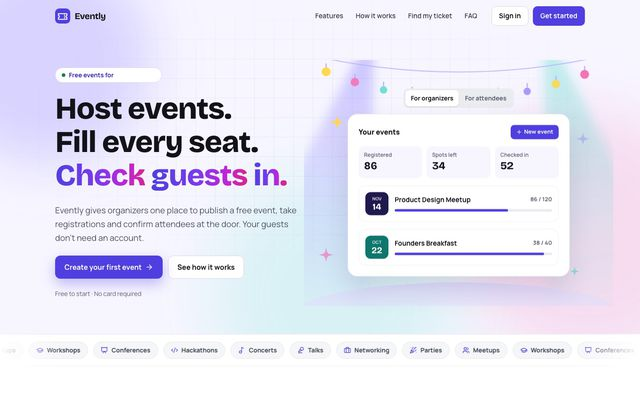</a>
       <b><a href="https://evently-rho-six.vercel.app/">Evently</a></b> · Event registration & check-in
       <a href="https://evently-rho-six.vercel.app/">Live ↗</a> · <a href="https://github.com/dha-stix/evently">Code</a>
    </td>
    <td width="33%" valign="top">
      <a href="https://salesmoni.vercel.app/">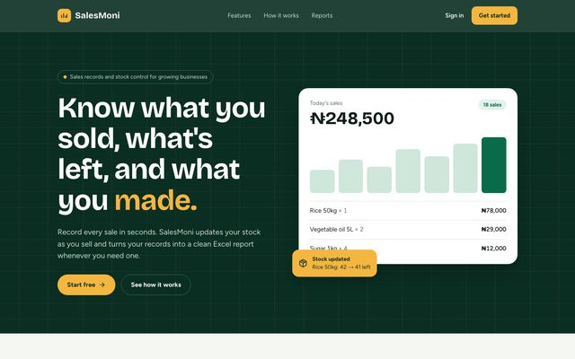</a>
       <b><a href="https://salesmoni.vercel.app/">SalesMoni</a></b> · Sales records & stock control
       <a href="https://salesmoni.vercel.app/">Live ↗</a> · <a href="https://github.com/dha-stix/salesmoni">Code</a>
    </td>
  </tr>
  <tr>
    <td width="33%" valign="top">
      <a href="https://keepr-swart.vercel.app/">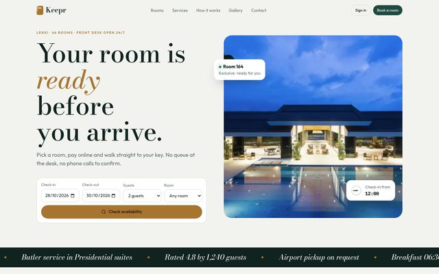</a>
       <b><a href="https://keepr-swart.vercel.app/">Keepr</a></b> · Hotel booking & front desk
       <a href="https://keepr-swart.vercel.app/">Live ↗</a> · <a href="https://github.com/dha-stix/keepr">Code</a>
    </td>
    <td width="33%" valign="top">
      <a href="https://stutest-ten.vercel.app/">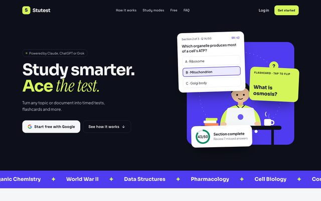</a>
       <b><a href="https://stutest-ten.vercel.app/">Stutest</a></b> · AI tests & flashcards from any topic
       <a href="https://stutest-ten.vercel.app/">Live ↗</a> · <a href="https://github.com/dha-stix/stutest">Code</a>
    </td>
    <td width="33%" valign="top">
      <a href="https://lnk-tau.vercel.app/">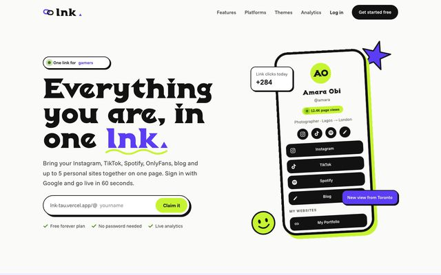</a>
       <b><a href="https://lnk-tau.vercel.app/">Lnk</a></b> · One link for everything you are
       <a href="https://lnk-tau.vercel.app/">Live ↗</a> · <a href="https://github.com/dha-stix/lnk">Code</a>
    </td>
  </tr>
  <tr>
    <td width="33%" valign="top">
      <a href="https://wearshop-eosin.vercel.app/">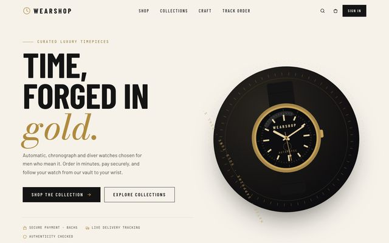</a>
       <b><a href="https://wearshop-eosin.vercel.app/">WearShop</a></b> · Luxury watch store
       <a href="https://wearshop-eosin.vercel.app/">Live ↗</a> · <a href="https://github.com/dha-stix/wearshop">Code</a>
    </td>
    <td width="33%" valign="top">
      <a href="https://coplan-delta.vercel.app/">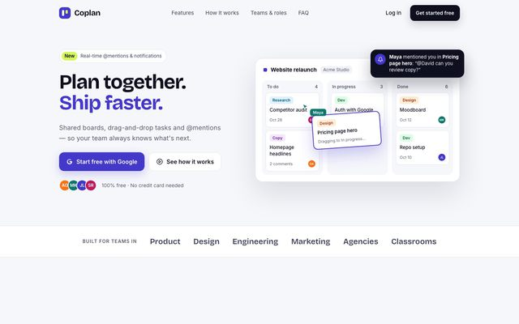</a>
       <b><a href="https://coplan-delta.vercel.app/">Coplan</a></b> · Team boards & planning
       <a href="https://coplan-delta.vercel.app/">Live ↗</a> · <a href="https://github.com/dha-stix/coplan">Code</a>
    </td>
    <td width="33%" valign="top">
      <a href="https://scoop-six-sand.vercel.app/">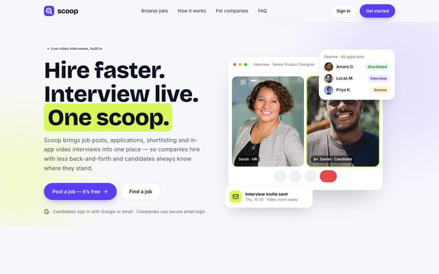</a>
       <b><a href="https://scoop-six-sand.vercel.app/">Scoop</a></b> · Hiring with live video interviews
       <a href="https://scoop-six-sand.vercel.app/">Live ↗</a> · <a href="https://github.com/dha-stix/scoop">Code</a>
    </td>
  </tr>
</table>

### 🧰 Tools I reach for

### 📫 Say hello

      

Writing and videos update daily from <a href="https://davidasaolu.dev">davidasaolu.dev</a>.
